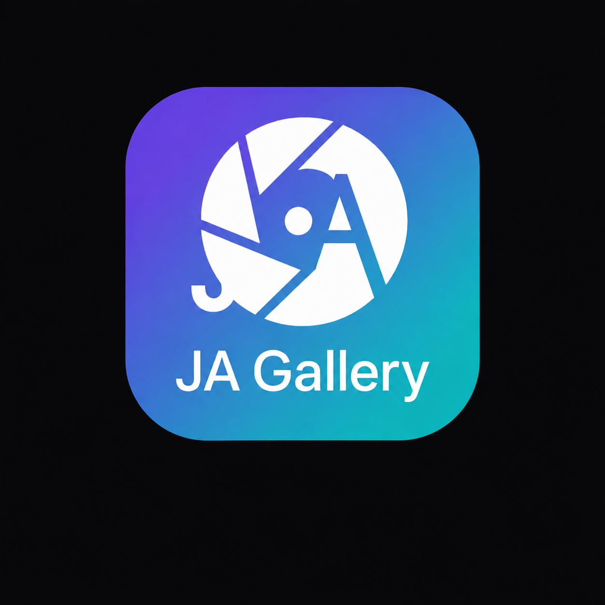

# JAGallery - Advanced Android Gallery Application

<p align="center">
  
</p>

<p align="center">
  <a href="https://github.com/aktarjabed/JAGallery/releases/latest"></a>
  
  
  
</p>

JAGallery is a modern, high-performance Android gallery application built with Jetpack Compose, Kotlin Coroutines & Flow, Material 3, Room, and Hilt.

> **📦 [Download the latest APK →](https://github.com/aktarjabed/JAGallery/releases/latest)**

[Implementation Status → IMPLEMENTATION_MATRIX.md](IMPLEMENTATION_MATRIX.md)

## Key Features

- **Album View**: Displays media grouped by folders/albums with item counts and cover thumbnails.
- **Media Grid**: Responsive 3-column thumbnail grid with multi-selection mode (long press to select, select all, batch delete, batch share).
- **Fullscreen Media Viewer**:
  - **Image Viewing**: High-definition image viewer with pinch-to-zoom (1x - 5x) and pan gestures.
  - **Slideshow**: Auto-advance through images every 3 seconds.
  - **Video Playback**: Embedded Media3 ExoPlayer for videos, automatically pausing when swiped away or off-screen.
  - **Immersive View**: Single tap to toggle top bar and controls overlay.
  - **Favorites Persistence**: One-tap toggling of favorite status backed by Room database.
  - **Metadata Info Sheet**: Displays file details including file name, MIME type, date added, album name, and EXIF metadata.
  - **Single & Batch Sharing**: Native Android sharing integration for single or multiple selected media files.
  - **Open With**: Launch media in external applications using secure Content URIs.
  - **Set Wallpaper**: Quickly set images as the device wallpaper.
- **Search & Filtering**: Search media files by name in real-time.
- **Image Editing**: Interactive Image Editor supporting freeform crop, rotation, flip horizontal/vertical, brightness, contrast, and saturation.
- **Video Editing**: Video trimming pipeline with bottom sheet UI.
- **Trash Management**: View deleted media and empty trash to permanently delete items. (MediaStore trash/restore integration with robust batch deletion tracking)
- **Hidden Media**: Hide sensitive media files and view or unhide them in a dedicated section.
  - *Note: Hidden media is only filtered from this app's view. Files remain in device storage and are visible to other apps and file managers.*
- **Map View**: OsmDroid-based map view with marker rendering using EXIF GPS metadata.
- **Duplicate & Similar Detection**: Find exact duplicate media files via SHA-256 caching, and detect visually similar photos (bursts/screenshots) using 64-bit Perceptual Hashing (dHash).
- **MediaStore & Handling**:
  - Full support for Scoped Storage (API 31+) using `MediaStore.createDeleteRequest` and `createTrashRequest`.
  - Batch operation handling with `PendingIntent` chunks and strict success/failure tracking.
  - Copy and Move operations preserving Room metadata and avoiding complete data loss on partial failures.

- **Secure Hidden Vault**: Biometric authentication (`androidx.biometric`), AES-256-GCM Keystore encryption, auto-lock mechanism, and App-private encrypted storage.
- **Smart Intelligence**: 
  - **OCR Text Extraction:** Google ML Kit `TextRecognition` scans documents and images for text, enabling full-text search.
  - **Image Labeling:** Google ML Kit `ImageLabeling` automatically categorizes photos (e.g. food, pets, landscapes).
  - **Smart Albums:** Automatically groups photos by semantic labels or detected text.
- **Natural Language Search**: Intent-based search to quickly query images by semantics or source.
- **Configurable Trash Retention**: Policy-driven cleanup (7, 30, 60 days, or Never) executed via resilient idempotent `WorkManager` tasks.

## Tech Stack

| Category | Technology |
|---|---|
| **Language** | Kotlin 2.0 |
| **UI** | Jetpack Compose + Material 3 (Material You) |
| **Architecture** | MVVM (ViewModel + StateFlow) |
| **DI** | Hilt / Dagger |
| **Database** | Room |
| **Image Loading** | Coil (with `VideoFrameDecoder`) |
| **Video Player** | Media3 ExoPlayer |
| **Maps** | OsmDroid |
| **ML / AI** | Google ML Kit (Image Labeling, Text Recognition) |
| **Security** | Android Keystore + AES-256-GCM, BiometricPrompt |
| **Background** | WorkManager |
| **Build** | Gradle (Kotlin DSL), KSP |

## Threat Model (Secure Vault)

The Vault feature protects files using Android Keystore and AES-256-GCM.
- Media is encrypted using randomly generated streaming IVs and cannot be read without the specific device Keystore credentials.
- Vault items are strictly hidden from MediaStore.
- Upon viewing or sharing, temporary decrypted `content://` streams are generated inside the app's cache directory and proactively cleared on lifecycle events or explicit navigation.

## Architecture

- **MVVM Pattern**: ViewModels manage UI state using Kotlin StateFlow.
- **Dependency Injection**: Powered by Google Hilt (`@HiltViewModel`, `@AndroidEntryPoint`).
- **Database**: Room Database handles local persistence for favorites, tags, hashes, and hidden states.
- **Media Loading**: Coil image loading library with `VideoFrameDecoder` support.
- **Navigation**: Jetpack Compose Navigation with URL-encoded string route parameter passing.

## Roadmap & Upcoming Features

- **Advanced Editor Controls**: Highlights, shadows, and sharpness.
- **Cloud-aware Albums**: Syncing logic and custom-album organization.

## Project Setup & Testing

### Prerequisites
- **JDK 17** — Required for compilation. Install [Microsoft OpenJDK 17](https://learn.microsoft.com/en-us/java/openjdk/download#openjdk-17), [Adoptium Temurin 17](https://adoptium.net/), or any OpenJDK 17 distribution.
- **Android SDK** — Install via [Android Studio](https://developer.android.com/studio) or the [command-line tools](https://developer.android.com/studio#command-line-tools-only). Ensure `local.properties` contains your SDK path (e.g. `sdk.dir=C:/Users/<you>/AppData/Local/Android/Sdk`).
- **`JAVA_HOME`** — Must point to your JDK 17 installation. Set it permanently:
  ```powershell
  # Windows (PowerShell)
  [System.Environment]::SetEnvironmentVariable("JAVA_HOME", "C:\Program Files\Microsoft\jdk-17.0.20.101-hotspot", "User")
  ```
  ```bash
  # macOS / Linux
  export JAVA_HOME=$(/usr/libexec/java_home -v 17)  # macOS
  export JAVA_HOME=/usr/lib/jvm/java-17-openjdk      # Linux (path may vary)
  ```

### Building the Project (Local APK)
You can generate a debug APK for testing directly on your device by running:
```bash
./gradlew assembleDebug
```
Once the build completes, the APK will be available at:
`app/build/outputs/apk/debug/app-debug.apk`

Transfer this file to your Android device to install and test the app.

### Building a Release APK
```bash
./gradlew assembleRelease
```
The signed release APK (with ProGuard/R8 minification) will be at:
`app/build/outputs/apk/release/app-release.apk`

### Running Unit Tests
```bash
./gradlew testDebugUnitTest
```

## Download

JAGallery is distributed exclusively via GitHub Releases. No Google Play Services, no analytics, no bloat.

**📦 [Download the latest APK from Releases →](https://github.com/aktarjabed/JAGallery/releases/latest)**

You can also browse [all releases](https://github.com/aktarjabed/JAGallery/releases).

## License

This project is proprietary software. All rights reserved.
